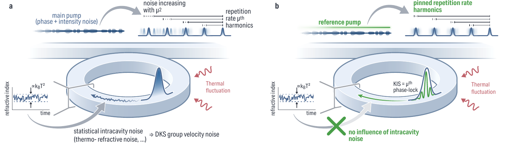
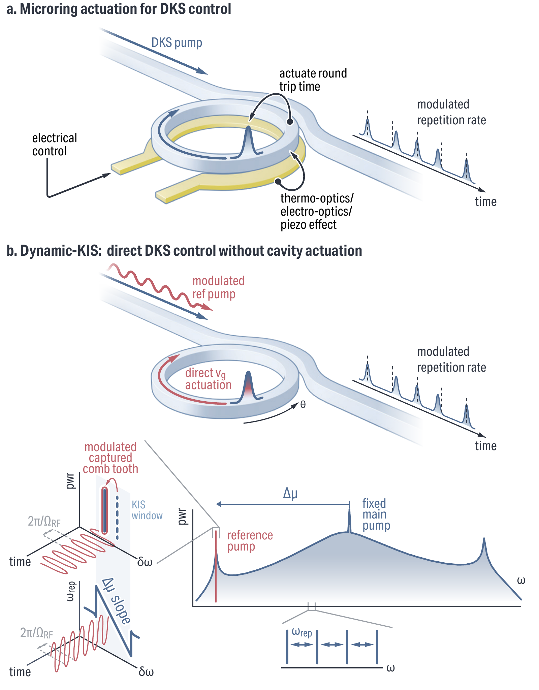
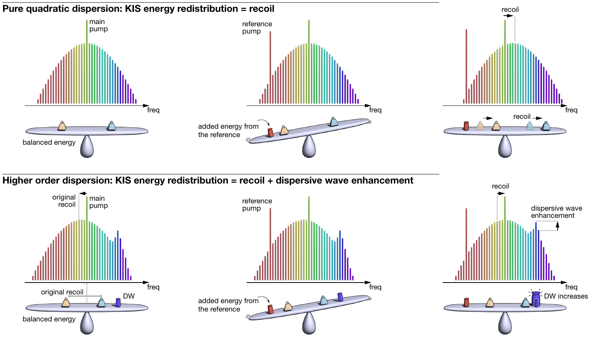
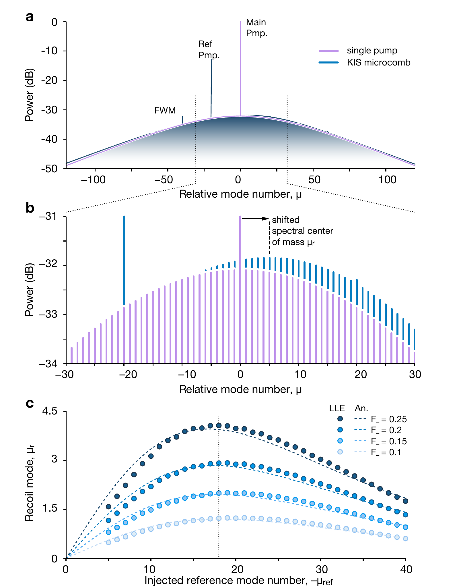
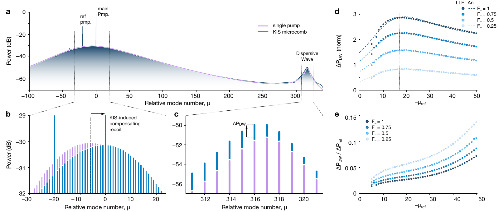
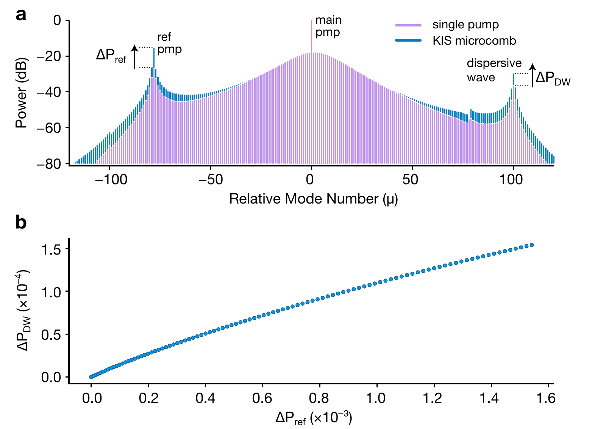
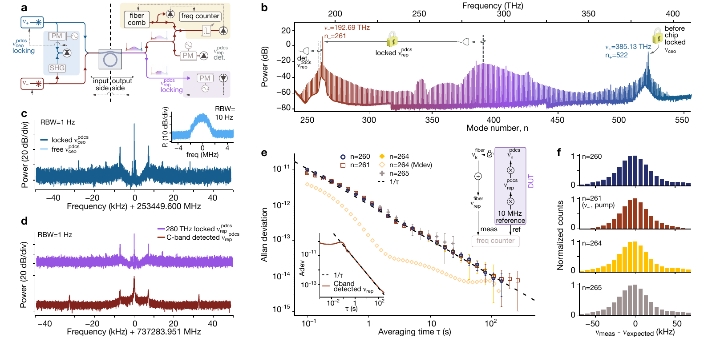
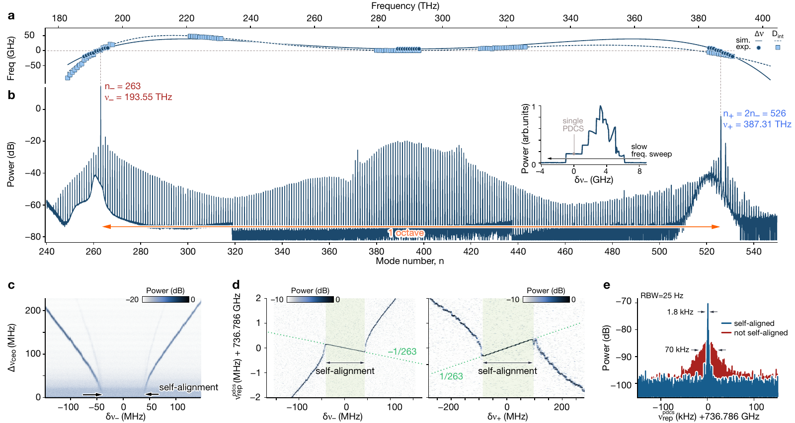
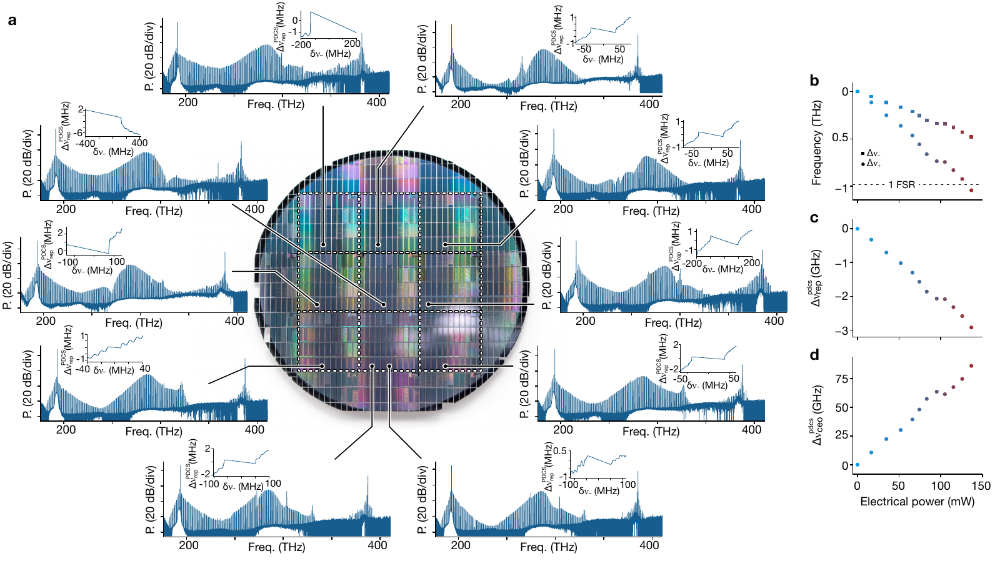

# Example 4: Figures in published papers

Figures are reproduced from the source files of the papers; the published versions may differ slightly in layout.

This example applies [04 — Figures construct the argument](../Writing/04-Figures.md) from the [main guide](../README.md). Each block names the rule, then shows it in the group's published figures and captions.

### Figure 1 is the concept ([Rule 1](../Writing/04-Figures.md#the-set-of-figures))

The conventional approach is drawn next to the new one.

Top to bottom: All-optical noise quenching, Dynamic tuning of soliton microcomb repetition rate, DKS self-balancing.

| Paper | Figure 1 |
|---|---|
| All-optical noise quenching, Optica 2025 | "DKS thermo-refractive noise and its circumvention through Kerr-induced synchronization (KIS)": **(a)** single pump scenario, then KIS |
| Dynamic tuning of soliton microcomb repetition rate, Optics Continuum 2025 | "Kerr-induced synchronization for dynamic comb repetition rate tuning": **a** typical approach for repetition rate tuning, **b** dynamic-KIS |
| DKS self-balancing, PRA 2026 | "Soliton self-balancing mechanism through spectral energy redistribution under Kerr-induced synchronization": **a** single-pump DKS, **b** KIS regime |

### One figure per Results section, with the same words ([Rule 2](../Writing/04-Figures.md#the-set-of-figures))

  

DKS self-balancing, PRA 2026, Figs. 2, 3 and 4: one figure per Results section, and the same colors in all three (purple: single pump, blue: KIS, [rule 4](../Writing/04-Figures.md#the-set-of-figures)).

| Results section | Figure title |
|---|---|
| Self-balancing in purely quadratic dispersion resonators | Self-balancing in a pure quadratic integrated dispersion microresonator. |
| Self-balancing effect in presence of a dispersive wave | Demonstration of self-balancing effect in the presence of a single DW. |
| Dispersive wave enhancement with quartic dispersion | Numerical demonstration of DW power enhancement due to self-balancing. |

DKS self-balancing, PRA 2026. In the self-aligned PDCS paper (Nature 2026), the section "Self-aligned PDCS metrology: microwave to optical link and vice versa" has two figures, "Microwave-to-optical link: …" and "Optical-to-microwave link: …".

### The setup is panel a, simplified ([Rule 3](../Writing/04-Figures.md#the-set-of-figures))

| Paper, figure | Caption |
|---|---|
| Self-aligned PDCS, Nature 2026, Fig. 4 | **a** Simplified experimental setup for optical frequency synthesis using a self-aligned PDCS microcomb. |

### One color per physical object, the same in every figure ([Rule 4](../Writing/04-Figures.md#the-set-of-figures))

 

Self-aligned PDCS, Nature 2026, Fig. 2 (left) and Fig. 4 (right).

| Color | Object | Where it appears |
|---|---|---|
| Red | the pump at $\nu_-$ (C-band) | Fig. 2b label $n_-$, $\nu_-$; Fig. 4a laser $\nu_-$; Fig. 4b red side of the spectrum and its label; Fig. 4d "C-band detected $\nu_\mathrm{rep}^\mathrm{pdcs}$" |
| Blue | the pump at $\nu_+$ (visible) | Fig. 2b label $n_+$, $\nu_+$; Fig. 4a laser $\nu_+$ and its $\nu_\mathrm{ceo}^\mathrm{pdcs}$ locking path; Fig. 4b blue side of the spectrum and its label |
| Purple | the $\nu_\mathrm{rep}^\mathrm{pdcs}$ locking path | Fig. 4a locking branch; Fig. 4b purple part of the spectrum; Fig. 4d "280 THz locked $\nu_\mathrm{rep}^\mathrm{pdcs}$" |

The setup in Fig. 4a uses the same colors as the spectra and traces it produces, so the reader follows each signal from the bench to the data.

In DKS self-balancing (PRA 2026), purple is the single-pump soliton and blue the KIS soliton in Figs. 2, 3 and 4 (shown above, rule 2).

### Markers for data, lines for models, defined in the caption ([Rules 5 and 8](../Writing/04-Figures.md#the-set-of-figures))

Self-aligned PDCS, Nature 2026, Fig. 2a, shown above.

| Paper, figure | Caption |
|---|---|
| Self-aligned PDCS, Nature 2026, Fig. 2a | OPO frequency mismatch $\Delta\nu$ (circles: measured, solid line: simulation) […] PDCS integrated dispersion $D_{\mathrm{int}}(n-n_0)$ (squares: measured, dashed line: simulation) |

### The bold title states the message ([Rule 6](../Writing/04-Figures.md#the-caption))

The same figure illustrates rule 10 below.

| Plot type | Message (published) |
|---|---|
| Optical spectra of ten devices | **Wafer-scale self-aligned PDCS yield and active thermal tuning** (Self-aligned PDCS, Nature 2026, Fig. 3) |

### The panel ends with what it confirms ([Rule 10](../Writing/04-Figures.md#the-caption))

| Paper, figure | Caption |
|---|---|
| Self-aligned PDCS, Nature 2026, Fig. 3a | For 10 devices sampled across the wafer with purposely different coupler designs, […] the corresponding self-aligned PDCS optical spectrum is shown alongside the repetition rate variation against $\delta\nu_-$ (inset), confirming self-alignment and robustness against coupling variations, thickness variations, and wafer-scale fabrication imperfections […] |
